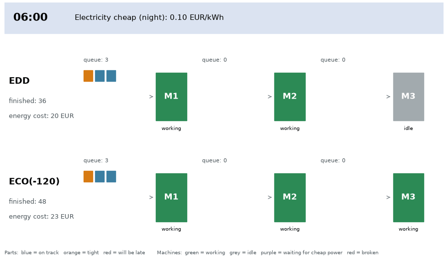
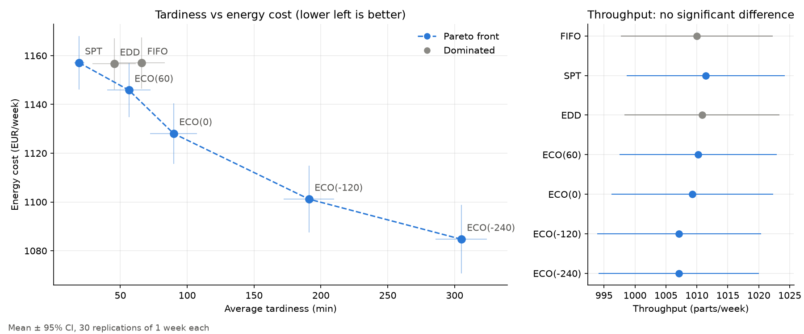

# Energy-aware dispatching rules in a simulated production line

A small discrete-event simulation (DES) study in Python and [SimPy](https://simpy.readthedocs.io/).
It compares classic dispatching rules (FIFO, SPT, EDD) with an **energy-aware rule (ECO)** on a
3-machine production line with random machine breakdowns and a time-of-use electricity price.
The rules are evaluated on **throughput, lead time, tardiness, machine utilization and energy cost**,
with 30 replications, 95% confidence intervals and a Pareto (trade-off) analysis.



*One simulated day, 06:00 to 22:00, with the same parts and breakdowns for both rules. At 08:00
electricity becomes expensive: EDD keeps working, while the energy-aware ECO rule waits (purple) and
its queues grow. After 20:00 electricity is cheap again and ECO catches up. Squares are waiting parts,
colored by urgency (blue = on track, orange = tight, red = will be late).*



## The model

```
arrivals ──► [queue] M1 ──► [queue] M2 ──► [queue] M3 ──► finished
```

| Element | Assumption |
|---|---|
| Arrivals | Poisson process, mean inter-arrival time 10 min |
| Processing times | Exponential, means 6 / 8 / 6 min on M1 / M2 / M3 (M2 is the bottleneck, 80% load) |
| Due dates | arrival + k × total work, k ~ Uniform(2, 6) |
| Breakdowns | Time to failure ~ Exp(MTBF = 8 h), repair ~ Exp(MTTR = 30 min), availability ≈ 94%. Interrupted work resumes after the repair (preempt-resume). |
| Power | busy 15 kW, idle 5 kW, broken 1 kW |
| Electricity price | 0.30 EUR/kWh from 08:00 to 20:00, 0.10 EUR/kWh at night |

Each machine keeps its own queue. When it becomes free, it asks a **dispatching rule** which part to process next:

| Rule | Picks the part with… |
|---|---|
| **FIFO** | the longest waiting time at this machine |
| **SPT** | the shortest processing time on this machine |
| **EDD** | the earliest due date |
| **ECO(x)** | like EDD, but in expensive hours a part is only started if its slack < x minutes; otherwise the machine waits for cheap electricity. *Slack = due date − now − remaining work.* |

The model was validated against simple queueing results: long runs reproduce the expected
throughput (144 parts/day), utilizations (60 / 80 / 60%) and availability (MTBF / (MTBF + MTTR)).

## How to run

Requires Python 3.10 or newer.

```bash
git clone https://github.com/<your-username>/energy-aware-dispatching-des.git
cd energy-aware-dispatching-des
python -m venv .venv
source .venv/bin/activate          # Windows: .venv\Scripts\activate
pip install -r requirements.txt

python model.py          # prints the first simulated hour event by event
python experiment.py     # full experiment: results table, paired comparisons, tradeoff.png
python animate.py        # animated GIF of one day, EDD vs ECO(-120): line.gif
```

The full experiment (7 rules × 30 replications) takes a few seconds. Fixed seeds make every result exactly reproducible.

| File | Content |
|---|---|
| `model.py` | The SimPy model: parts, machines, breakdowns, energy and price |
| `rules.py` | The dispatching rules (FIFO, SPT, EDD, ECO) |
| `experiment.py` | Replications, warm-up, confidence intervals, Pareto front, plot |
| `animate.py` | Animated GIF of the line (visualization only, not used for the results) |

## Experimental design

- **Run length:** 1 day warm-up (statistics are deleted afterwards, to remove the bias of starting with an empty line) + 1 week of measured production.
- **Replications:** 30 per rule, results reported as mean ± half-width of the 95% confidence interval (t-distribution).
- **Common random numbers:** every rule uses the same 30 seeds, with separate random streams for arrivals and for each machine's failures. So all rules see the same parts and the same breakdowns, and rules are compared with **paired** confidence intervals.
- **Pareto front:** a rule dominates another if it is significantly better (paired 95% CI) on at least one objective (throughput ↑, tardiness ↓, energy cost ↓) and not significantly worse on any.

## Results

| Rule | Throughput (parts/week) | Avg lead time (min) | Avg tardiness (min) | Utilization M2 (%) | Energy cost (EUR/week) |
|---|---|---|---|---|---|
| FIFO | 1010.0 ± 12.3 | 128.8 ± 19.7 | 65.9 ± 17.5 | 80.8 ± 1.8 | 1157.0 ± 10.5 |
| SPT | 1011.4 ± 12.8 | **69.4 ± 5.0** | **19.3 ± 3.7** | 80.8 ± 1.8 | 1157.1 ± 11.0 |
| EDD | 1010.8 ± 12.5 | 109.4 ± 18.3 | 45.5 ± 16.2 | 80.9 ± 1.8 | 1156.6 ± 10.5 |
| ECO(60) | 1010.2 ± 12.7 | 125.6 ± 17.7 | 56.4 ± 16.2 | 80.8 ± 1.8 | 1145.8 ± 11.0 |
| ECO(0) | 1009.3 ± 13.0 | 166.1 ± 18.3 | 89.8 ± 17.6 | 80.7 ± 1.7 | 1128.1 ± 12.4 |
| ECO(-120) | 1007.1 ± 13.2 | 270.4 ± 19.2 | 191.1 ± 18.9 | 80.7 ± 1.7 | 1101.2 ± 13.7 |
| ECO(-240) | 1007.1 ± 12.9 | 385.2 ± 19.4 | 305.0 ± 19.1 | 80.6 ± 1.7 | **1084.7 ± 14.0** |

Paired differences (same seeds):
- **ECO(0) − EDD:** energy cost **−28.6 ± 3.0 EUR/week**, tardiness **+44.3 ± 4.9 min** (both significant).
- **SPT − EDD:** tardiness **−26.2 ± 12.7 min** (significant), energy cost +0.4 ± 1.7 EUR/week (not significant).

**Pareto-optimal rules:** SPT, ECO(60), ECO(0), ECO(-120), ECO(-240). FIFO and EDD are dominated by SPT.

### Which rule for which goal?

| Goal | Best choice |
|---|---|
| Low tardiness and lead time | **SPT** (no extra energy cost) |
| Low energy cost | **ECO** with a low slack limit, e.g. ECO(-240): −6% cost, but much more tardiness |
| Balance | **ECO(60)** or **ECO(0)** |
| Throughput | No difference: in a stable line, throughput = arrival rate |
| Worst-case tardiness | **EDD** has the lowest *maximum* tardiness, even though it is dominated on average tardiness |

### Main findings

1. **Classic rules change the order of work, not the energy cost.** FIFO, SPT and EDD do the same total work, so their energy costs are equal. To reduce energy *cost*, a rule must change *when* the work is done.
2. **Energy saving has a price in tardiness.** The ECO family forms a clear trade-off curve, and the savings get more and more expensive: going from ECO(0) to ECO(-240) saves 43 EUR/week more but adds about 215 min of average tardiness.
3. **High load limits load shifting.** The bottleneck M2 must be busy about 80% of the time, so it cannot move its work into the 12 cheap hours. This is why the savings are only a few percent here. They would be larger with lower load.
4. **Disruptions hurt most at the bottleneck.** Breakdowns take only about 6% of the time, but they almost double the average lead time (68 → 121 min with FIFO).
5. **Use paired comparisons.** The separate confidence intervals of EDD and ECO(0) overlap, but the paired CI shows a clear, significant difference.

## What I learned

- How discrete-event simulation works: an event list, processes as Python generators, and a simulation clock that jumps from event to event.
- How to model disruptions with SimPy interrupts, and why the bottleneck reacts most strongly.
- How to design a simulation experiment: warm-up period, independent replications, confidence intervals, common random numbers and paired comparisons.
- To validate a model against values I can calculate by hand before trusting its results.
- That there is rarely one "best" dispatching rule. The answer depends on the objective, the load and the due dates, so a Pareto analysis is more honest than one ranking.
- That energy-aware scheduling is about **timing** (when to use energy), not only about the order of jobs.

## Limitations

- One product type, no setup times, a serial line, and an infinite buffer between machines.
- Processing times are assumed known when a part is waiting (needed for SPT and slack).
- Machines stay at idle power while waiting. They cannot switch to standby or turn off.
- Simple two-level electricity price. Real prices are dynamic and partly uncertain.
- Parameters are illustrative, not fitted to data from a real factory.

## Future work

- **Reinforcement learning for rule selection:** wrap the simulation as an RL environment (e.g. with the Gymnasium API). At each decision point an agent sees the state (queue lengths, machine states and failures, current and upcoming electricity price, slack of waiting parts) and chooses which dispatching rule to apply, or whether to wait. The reward combines tardiness and energy cost. The trained policy is evaluated with the same replication and confidence-interval design and compared with the fixed rules and their Pareto front.
- **LLM-based agents that generate dispatching rules:** an LLM proposes new rules as Python functions (in the same form as `rules.py`), in response to disruptions (e.g. a breakdown at the bottleneck) and energy prices. The simulation evaluates each rule and the results are fed back to the LLM so it can improve it, similar to LLM-guided program search such as FunSearch, or to genetic-programming hyper-heuristics for dispatching rules. The simulation acts as a safe test bed before a rule is used on a real shop floor.
- **Better energy-aware rules:** an ECO rule built on SPT instead of EDD, machine standby / switch-off decisions, and dynamic or forecast electricity prices.
- **More realistic disruptions and objectives:** rush orders, operator absence, maximum tardiness and fairness as additional objectives, and multi-objective optimization (e.g. NSGA-II) of rule parameters such as the ECO slack limit.
